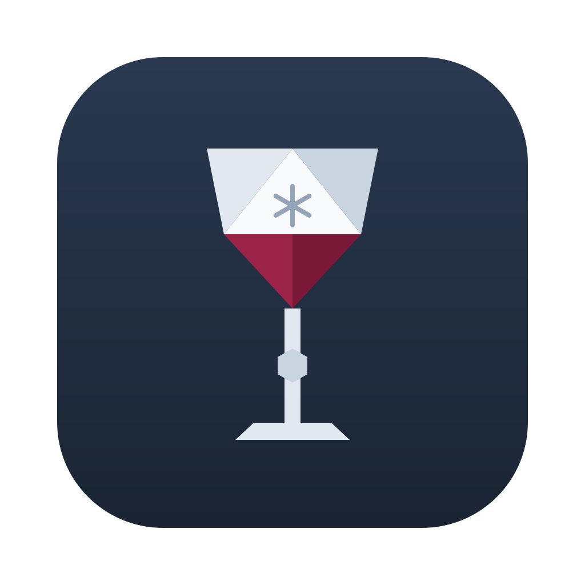

<p align="center">
  
</p>

<h1 align="center">Vinter</h1>

<p align="center"><strong>Windows apps, poured onto your Mac.</strong><br>
Run Windows programs on macOS and Linux, without a Windows license or a virtual machine.</p>

<p align="center"><a href="https://getvinter.app">getvinter.app</a></p>

---

Vinter is a desktop app that sets up and runs Windows programs using
[Wine](https://www.winehq.org), the open-source compatibility layer. It
does not reimplement Windows: it downloads Wine builds, keeps each app in its
own self-contained environment (a *bottle*), installs apps from their official
installers, and lets you launch them like any other app on your computer.

> **Status: early development.** Plenty of Windows software runs well and
> plenty does not yet. The current version is 0.1.9.

## Download

- **Mac (Apple Silicon):** [Vinter for Mac](https://getvinter.app/download/mac) (.dmg)
- **Linux (x86_64):** [Vinter for Linux](https://getvinter.app/download/linux) (.AppImage),
  or the `.deb` from the [latest release](https://github.com/praevit/vinter/releases/latest)

Or with [Homebrew](https://brew.sh):

```sh
brew install --cask praevit/tap/vinter
```

Vinter is not notarized by Apple yet. The first time you open it, macOS asks
you to confirm: try to open Vinter, then go to **System Settings → Privacy &
Security** and click **Open Anyway**.

## Features

- **Bottles**: one Windows environment per app, with its own C: drive and
  Windows version. Create, duplicate, back up and restore them.
- **One-click apps**: pick an app (Notepad++, 7-Zip, WinRAR, SumatraPDF, Total
  Commander, PuTTY, …) and Vinter downloads its official installer, checks it,
  and sets everything up. You can write your own recipes.
- **Open any installer**: double-click a Windows `.exe`, `.msi` or `.msix`,
  drop it on Vinter, or install it into a bottle; Vinter finds the programs it
  installed.
- **Feels like a Mac app**: Retina mode, ⌘ works as Ctrl, and installers keep
  their shortcuts out of your Mac's Desktop.
- **Launch from anywhere**: your apps show up in Spotlight, Launchpad, Raycast
  and the Linux app menu, and in Vinter's menu bar icon.
- **Graphics backends**: Wine's built-in renderer, DXVK (Direct3D 11 over
  Vulkan), DXMT (Direct3D 10/11 over Metal) or Apple's D3DMetal (Direct3D
  11/12, from the Game Porting Toolkit you download from Apple) per bottle,
  with a one-click test and a frame rate overlay.
- **Logs**: every run gets its own log, with live output and a debug report you
  can copy into a bug report.
- **Housekeeping**: see how much space each bottle takes, clean up old logs
  and temp files, and update Wine runtimes with your bottles moving along.
- **Wine runtimes**: downloaded from their publishers and verified by checksum
  before anything is installed.

## Platforms

| Platform | Status |
|---|---|
| macOS on Apple Silicon | Main target. Today's Wine builds for Mac need Rosetta 2, which Vinter offers to install. |
| Linux x86_64 | Supported, less tested. |
| Intel Macs | Not supported yet. |

Apple is limiting Rosetta 2 in a future macOS release; native Apple Silicon
runtimes are on the roadmap.

## Building from source

Requirements: [Rust](https://rustup.rs) (stable), Node.js 22+, and the Tauri CLI:

```sh
cargo install tauri-cli --version "^2" --locked
```

Then:

```sh
git clone https://github.com/praevit/vinter.git
cd vinter/app && npm install && cd ..
cargo tauri dev            # run the app in development mode
```

On Linux you also need the usual Tauri dependencies (WebKitGTK and friends);
see the [Tauri prerequisites](https://v2.tauri.app/start/prerequisites/).

Links from launchers (`vinter://`) only work from an installed app bundle, not
in development mode.

### Command line

Everything the app does is also available from the `vinter` command-line tool:

```sh
cargo run -p vinter-cli -- --help
cargo run -p vinter-cli -- check                          # is this machine ready?
cargo run -p vinter-cli -- recipe list
cargo run -p vinter-cli -- recipe apply notepad-plus-plus  # one-click install, from the terminal
cargo run -p vinter-cli -- bottle list
```

### Checks

```sh
scripts/check.sh   # formatting, lints, tests and the frontend build
```

## Project layout

```
crates/vinter-core   all system logic: runtimes, bottles, recipes, graphics, launchers
crates/vinter-cli    the `vinter` command-line tool
app/src-tauri        the desktop app (Tauri v2): thin commands over vinter-core
app/src              the interface (React, TypeScript, Tailwind)
recipes/             built-in app recipes
site/                the getvinter.app website
tools/d3dprobe       tiny Windows program used by "Test graphics"
```

## Recipes

A recipe is a small TOML file describing how to set up one app: where its
installer comes from, which settings and components it needs, and which
programs to add. See the built-in ones in [`recipes/`](recipes/). Your own
go in the `recipes` folder inside Vinter's data folder, and can be checked with
`vinter recipe check <file>`.

## Contributing

Bug reports and recipes for apps you got working are very welcome:
[open an issue](https://github.com/praevit/vinter/issues). Please include the
debug report from the bottle's **Logs** tab.

## Supporting Vinter

Vinter is free. If it is useful to you, you can
[sponsor its development on GitHub](https://github.com/sponsors/praevit).

## License

Vinter is free software: you can redistribute it and/or modify it under the
terms of the [GNU General Public License](LICENSE), version 3 or (at your
option) any later version. Copyright © 2026 Prævit ehf.

"Vinter" and the Vinter logo are trademarks of Prævit ehf. The license covers
the code, not the name or logo: if you distribute a modified version, please
give it a different name.

## Credits

Vinter is built on [Wine](https://www.winehq.org), licensed under the LGPL.
Graphics use [DXVK](https://github.com/doitsujin/dxvk) (zlib),
[DXMT](https://github.com/3Shain/dxmt) (LGPL) and MoltenVK (Apache 2.0); some
recipes use [winetricks](https://github.com/Winetricks/winetricks) (LGPL).
These are downloaded from their publishers, not bundled.

**Vinter Wine** is built by this repository's GitHub Actions and published,
with its source and changes, as `wine-*` pre-releases (see [`wine/`](wine/)):
11.0 is upstream Wine with a small patch so DXMT can draw; 11.19 is built from
[WineForge](https://github.com/Alien4042x/WineForge) (Wine with D3DMetal
support) with a startup fix. Vinter never includes Apple's D3DMetal: you
import your own copy of the Game Porting Toolkit, under Apple's license.

Vinter is not affiliated with Wine, Apple or Microsoft.

Made in Iceland by Prævit ehf. Contact: hello@getvinter.app
